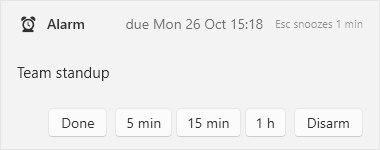

# Tasketier

[](https://github.com/meet-brad-ch/Tasketier/actions/workflows/build.yml)
[](https://github.com/meet-brad-ch/Tasketier/releases/latest)
[](LICENSE)

**What:** A task tool for Windows that keeps all data on the PC. A global hotkey opens a one-line
box. You type the task with inline marks (`@tomorrow`, `@15:30`, `!`, `#tag`) and press Enter. A
list window shows Today, Upcoming, Inbox, All and Done. A tray icon keeps the app running.
`tasketier.exe` gives the same store a command line and an MCP server. A Claude Code plugin in
this repo tells an LLM how to use it.

**Why:** Tasks that come to mind during the day get lost, because writing them down takes too
much attention. Capture must take less than two seconds from any window. The daily look-through
must show what is due, what is planned for today and what is done. An LLM must be able to add and
query tasks from a running session.

**Status:** working. Capture box, list window with the five views, inline edit, plan star, undo,
alarms, settings, help, tray, autostart, CLI, MCP server, plugin, installer. Every gate of
`scriptserify.ps1` passes.

## Screenshots

The capture box opens from any window with `Ctrl+Alt+A`. The line below the text shows what the
parser read from it, before you press Enter:


`?` or `F1` shows every mark:


The list window, Today view. Overdue tasks come first, in red. Then the tasks due today. Then the
task planned for today, with the star. The marks stand in front of the title, the tags under it:


An alarm card. It beeps until you answer it. Done completes the task, the three middle buttons
snooze, Disarm acknowledges, and `Esc` snoozes one minute:



## How to run

```
dotnet build Tasketier.slnx
dotnet test  Tasketier.slnx
dotnet run   --project src\Tasketier.App                 # tray, hotkeys, the list window
dotnet run   --project src\Tasketier.App -- --capture    # the capture box
dotnet run   --project src\Tasketier.App -- --tray       # icon only, as at Windows start-up
dotnet run   --project src\Tasketier.App -- --data D:\t  # another data folder; runs beside the normal instance
dotnet run   --project src\Tasketier.Cli -- add "Buy milk @tomorrow #home"
dotnet run   --project src\Tasketier.Cli -- list --view today
dotnet run   --project src\Tasketier.Cli -- mcp          # the MCP server on stdin/stdout
.\scripts\verify.ps1
.\build-installer.ps1
```

**Verify:** `.\scripts\verify.ps1` runs four gates. Build with warnings as errors (analyzers, code
style, nullable). Unit tests with coverage. The `dotnet format` check. Cyclomatic complexity
(lizard, limit 9). The script exits non-zero on any FAIL or NOT VERIFIED.

**Prerequisites:** Windows 11 (the installed app runs on Windows 10 1607 or later). .NET SDK
10.0.400 (`net10.0` and `net10.0-windows`). git. lizard (`pip install lizard==1.17.31`) for the
complexity gate. Inno Setup 7 (`C:\Program Files\Inno Setup 7`) for the installer. `nuget.config`
clears the machine-level feeds, so the build is the same on every machine.

## Install

`.\build-installer.ps1` writes `out\installer\Tasketier-Setup-<version>.exe`. The installer:

1. Copies `TasketierApp.exe` (the tray app) and `tasketier.exe` (the CLI and MCP server) into
   `C:\Program Files\Tasketier`.
2. Adds that folder to PATH.
3. Offers a start-with-Windows task.
4. Downloads the .NET Desktop Runtime 10.0 from Microsoft when it is missing. The installer
   checks the SHA-256 of the download.

Tasks and settings live in `%LOCALAPPDATA%\Tasketier`. An uninstall keeps them.

The Releases page has the installer of each version. CI (`.github/workflows/build.yml`) runs
`scriptserify.ps1` and `build-installer.ps1` on every push and keeps the installer as an
artifact. A tag `v1.2.3` makes the release with the installer and its SHA-256.

## Use

| Action | How |
| --- | --- |
| Add a task from anywhere | `Ctrl+Alt+A`, type, `Enter`. `Esc` cancels. The focus returns to the previous window. |
| Open the list | `Ctrl+Alt+L`, or a left click on the tray icon |
| Complete | The checkbox, or `Space` on the selected row |
| Plan for today without a date | The star (`☆` becomes `★`). The task stays in Today until it is done or unstarred. |
| Edit | The pencil at the end of the row, `F2`, or a double-click on the title. The row becomes one edit field with the whole line in inline syntax. `Enter` saves, `Esc` cancels. |
| Delete | `Del`. `Ctrl+Z` brings the task back. |
| Undo | `Ctrl+Z`. The app keeps the last 20 changes of the session, captures included. |
| Filter | Type in the filter box (`Ctrl+F`). The filter matches the title or a `#tag`. |
| Alarm | `@alarm` on a task with a time: a card in the corner 3 minutes before, with Done, Snooze 5 / 15 / 60 min and Disarm. It beeps until you answer it. `Esc` snoozes 1 minute. Only Disarm acknowledges. `@alarm10` means 10 minutes. The tray app must run. |
| Help | `?` or `F1` in the capture box or the list. Also in the tray menu. |
| Settings | Tray menu: both hotkeys, the alarm lead, the data folder, start with Windows |

You can change both hotkeys in Settings. When another program holds a chord, the tray shows a
message, and that hotkey stays off until you change it. The defaults avoid chords that common
tools hold, such as `Ctrl+Alt+Space` and `Ctrl+Alt+T`.

**Inline syntax:** Words are the title. `#tag` adds a tag. `!` is high priority, `!!` is urgent.
Both also work as a suffix: `Pay rent!!`. `@today`, `@tomorrow`, `@mon` to `@sun`, `@2026-11-03`,
`@+3d` and `@+2w` set the due day. A weekday means the next such day after today. `@15:30`
sets the time. Without a day, the time means today. `@none` removes the date. `@alarm` or `@alarm10` sets an alarm 3 or 10 minutes before the due time.
It needs a time. An unknown `@` mark is an error. The box shows it before you press Enter.

**Views:** Today shows overdue tasks first, in red, then tasks due today, then tasks planned for
today. Upcoming shows tasks due after today, by day. Inbox shows tasks with no date that are not
planned. All shows every open task, overdue first, then by due day, undated last. Done shows tasks
completed in the last 30 days.

**Command line:** `tasketier add|list|show|done|undone|edit|delete|plan|unplan|search|mcp|version`.
`--json` prints records for scripts. `--data <folder>` points at a different `tasks.json`.
`tasketier help` shows all commands.

## LLM access (MCP and plugin)

`tasketier mcp` is an MCP server on stdin and stdout. Its tools are `add_task`, `list_tasks`,
`get_task`, `complete_task`, `reopen_task`, `update_task`, `delete_task`, `plan_today` and
`search_tasks`. Each tool returns the changed records as JSON. A failed call returns its message.

The Claude Code plugin in `plugin\` contains a skill and the server registration. The skill says
which tool to use for which request, the inline syntax and the working rules. The registration
starts `${ProgramFiles}\Tasketier\tasketier.exe mcp`. To install the plugin in Claude Code:

```
/plugin marketplace add meet-brad-ch/Tasketier     # or a local clone: /plugin marketplace add C:\Apps\Projects\Tasketier
/plugin install tasketier@tasketier
```

The app, the CLI and the server share one file under a cross-process lock. The app reloads when
the file changes. A task that Claude adds appears in the list at once.

## Storage

The tasks are one JSON file: `%LOCALAPPDATA%\Tasketier\tasks.json`. You can move the folder in
Settings, for example to a synced folder. Each write goes to a temporary file first and then
replaces the real file in one step. The first write of each day copies the previous file to
`backups\tasks-<date>.json`. A damaged file causes an error that names the file. The app never
replaces a damaged file. There is no network access and no telemetry.

## Layout

- `src/Tasketier.Core/` — a library without UI code: task model, inline-syntax parser, JSON store
  (mutex, atomic replace, daily backup, file watcher), view queries, alarm scheduler, service, undo,
  settings.
- `src/Tasketier.App/` — WPF (`TasketierApp.exe`): capture window, list window, alarm card, help
  window, settings window, tray icon, global hotkeys, instance signals, autostart.
- `src/Tasketier.Cli/` — console (`tasketier.exe`): the commands and the `mcp` server
  (`ModelContextProtocol` 2.3.0).
- `plugin/` — the Claude Code plugin. `.claude-plugin/marketplace.json` at the root lists it.
- `tests/Tasketier.Core.Tests/`, `tests/Tasketier.Cli.Tests/` — xUnit. The CLI tests start the
  real exe as an MCP server and drive it with the SDK client.
- `installer/Tasketier.iss`, `build-installer.ps1` — the Inno Setup installer.
- `scripts/verify.ps1` — the quality gates.
- `tools/make_icon.py` — draws the icon. `tools/make_alarm_sound.py` — writes the alarm beeps.
  `tools/shoot_windows.ps1` — takes the README screenshots
  from a seeded data folder (see its header).
- `docs/img/` — the README screenshots.

## Design

- WPF on .NET 10. One framework-dependent exe for the app, one for the CLI. The installer
  bootstraps the runtime.
- The app is `TasketierApp.exe` and the CLI is `tasketier.exe`. Both live in one folder, and
  Windows file names ignore case, so both cannot be `Tasketier.exe`.
- One JSON file, not a database: a person can read it, there is no dependency, and the store
  holds some hundreds of tasks at most. A cross-process mutex keeps the app, the CLI and the MCP
  server from writing at the same time.
- LLM access is a stdio MCP server and a CLI in one exe over the shared store, not an HTTP server
  inside the app. It works when the app does not run, and the WPF app stays free of ASP.NET Core.
- The installer writes to `C:\Program Files\Tasketier` with elevation, because the .NET runtime
  bootstrap needs elevation. The plugin's `.mcp.json` finds the server through `${ProgramFiles}`.
- All text follows Simplified Technical English (ASD-STE100): short sentences, active voice, one
  meaning per word.

---

Keep this file honest. It is the only project document that is committed. `LOG.md` is gitignored,
so anything that must survive a fresh clone belongs here, not in the log.
